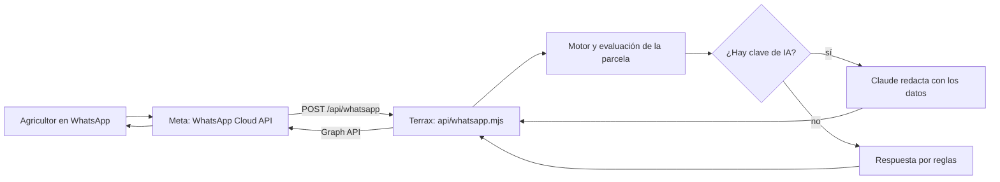

# WhatsApp y Terra

Terra atiende por WhatsApp con la API oficial de Meta (WhatsApp Cloud API). No hace falta n8n: Meta llama
directo a nuestra API y esta responde.

## Estado

- El código está desplegado y probado con mensajes simulados (ubicación, texto y BAJA).
- Falta la cuenta de Meta: sin las variables de abajo, la ruta responde pero no envía mensajes.

## Pasos que hace una persona

1. En developers.facebook.com: crear una app de tipo Business y agregar el producto WhatsApp.
2. En *API Setup*: anotar el *Phone Number ID* y registrar los teléfonos de prueba (máximo 5 con el número de prueba).
3. Crear un *System User* con un token que no caduque, con permisos `whatsapp_business_messaging` y
   `whatsapp_business_management`. El token temporal vence en unas 24 horas.
4. En Netlify, sitio de Terrax, *Environment variables*:
   - `WHATSAPP_VERIFY_TOKEN`: una frase cualquiera.
   - `WHATSAPP_TOKEN`: el token del paso 3.
   - `WHATSAPP_PHONE_NUMBER_ID`: el id del paso 2.
   - `WHATSAPP_APP_SECRET` (opcional): activa la verificación de firma de cada mensaje.
5. Volver a desplegar el sitio para que tome las variables.
6. En Meta, *Configuration* del webhook: URL `https://<sitio>/api/whatsapp`, la misma frase del paso 4, y
   suscribirse al campo `messages`.
7. Prueba: el teléfono registrado escribe «hola» al número. Terra pide la ubicación.

Regla de las 24 horas: Terra solo puede escribir libremente a quien le escribió en las últimas 24 horas.

## Cómo conversa

- Ubicación (clip, Ubicación): Terra guarda la parcela y responde con sus riesgos principales.
- «Distrito 9» o «Distrito 13»: usa un punto de ejemplo de ese distrito.
- «Sembré papa» y luego cualquier pregunta: qué sembrar, agua, heladas, lluvia, suelo, riesgos.
- «BAJA»: Terra olvida la parcela.

## Privacidad

No se guardan ni se registran números de teléfono. La parcela de cada chat vive en memoria, bajo un resumen
criptográfico del número, y se pierde cuando el servidor se reinicia.

## Pendiente de comprobar

- La versión de la Graph API (`WHATSAPP_GRAPH_VERSION`, por defecto `v21.0`): revisar cuál está vigente en Meta.
- Mensajes de voz: no están hechos.
