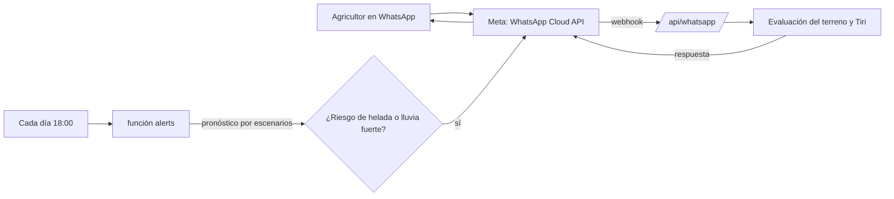

# WhatsApp: Tiri y los avisos con el número boliviano

Tiri responde por WhatsApp y envía avisos de helada y lluvia fuerte con la **API oficial de Meta (WhatsApp Cloud
API)**. No hace falta n8n: Meta llama directo a `https://yatirix-cochabamba.netlify.app/api/whatsapp`.



## Lo que ya funciona (probado con mensajes simulados)

- Conversación: ubicación por el clip, «Distrito 9», «sembré papa» y cualquier pregunta.
- **ALERTAS**: suscribe el terreno a los avisos. Desde la web, el botón «Activar avisos por WhatsApp» abre el chat
  con el texto `ALERTAS lat,lon` y queda suscrito con un solo envío.
- **BAJA**: borra la suscripción y el terreno guardado.
- Avisos diarios a las 18:00 (hora de Bolivia): se envían solo si 3 de cada 10 escenarios traen helada o 5 de cada 10
  traen 10 mm o más de lluvia en los próximos dos días. Como máximo un aviso por persona por día.
- Los teléfonos se guardan en Netlify Blobs (privado del sitio), nunca en el repositorio, y solo después de que la
  persona escribe ALERTAS.

## Paso a paso con el número boliviano (lo hace una persona del equipo)

**Antes de empezar:** el número **no puede estar activo en la app de WhatsApp ni en WhatsApp Business**. Si ya se
abrió una cuenta con ese chip, hay que borrarla desde la app (Ajustes → Cuenta → Eliminar cuenta) y esperar unos
minutos. Tengan el chip en un teléfono con señal para recibir el código por SMS o llamada.

1. Entrar a **developers.facebook.com** con una cuenta de Facebook → *Mis apps* → *Crear app* → tipo **Business**.
2. En la app, agregar el producto **WhatsApp**. Meta crea una cuenta de WhatsApp Business y un número de prueba.
3. *WhatsApp → API Setup → Add phone number*: poner el nombre visible («Yatiri X»), categoría (Agricultura o
   Educación), y el número con código de país: **+591** y los 8 dígitos. Elegir SMS o llamada y escribir el código
   que llega al chip.
4. Anotar el **Phone Number ID** que aparece junto al número nuevo (no es el número de teléfono).
5. **Token permanente:** en *business.facebook.com → Configuración del negocio → Usuarios del sistema*, crear un
   usuario del sistema, asignarle la app y la cuenta de WhatsApp, y *Generar token* con los permisos
   `whatsapp_business_messaging` y `whatsapp_business_management`. El token temporal de *API Setup* vence en 24 horas.
6. **Plantilla para los avisos** (WhatsApp solo deja escribir primero con plantillas aprobadas): en *WhatsApp Manager
   → Plantillas de mensaje → Crear*, categoría **Utilidad**, idioma **Español**, nombre `aviso_terreno`, cuerpo:

   > Aviso de Yatiri X para tu terreno: {{1}}

   Ejemplo para {{1}}: «posible helada esta noche: 6 de cada 10 escenarios bajan de 0 °C; cubre los almácigos».
   La aprobación suele tardar de minutos a unas horas.
7. En **Netlify → yatirix-cochabamba → Environment variables**, crear:

   | Variable | Valor |
   | --- | --- |
   | `WHATSAPP_TOKEN` | El token permanente del paso 5 |
   | `WHATSAPP_PHONE_NUMBER_ID` | El ID del paso 4 |
   | `WHATSAPP_VERIFY_TOKEN` | Una frase que inventen, sin espacios |
   | `WHATSAPP_PUBLIC_NUMBER` | El número con código de país, solo dígitos: `591` y los 8 dígitos. Es el que ve la gente en la web |
   | `WHATSAPP_ALERT_TEMPLATE` | `aviso_terreno` (cuando la plantilla esté aprobada) |
   | `WHATSAPP_APP_SECRET` | *Opcional:* el App Secret de la app (Configuración → Básica), para verificar la firma de cada mensaje |
   | `ALERTS_SECRET` | *Opcional:* una frase para lanzar un aviso de prueba en la demo |

8. Volver a desplegar el sitio (me lo piden y lo hago).
9. En la app de Meta: *WhatsApp → Configuration → Webhook*: URL `https://yatirix-cochabamba.netlify.app/api/whatsapp`,
   *Verify token* = la frase del paso 7, *Verify and save*, y suscribirse al campo **messages**.
10. Prueba: desde un teléfono, escribir «hola» al número. Tiri pide la ubicación. Luego «ALERTAS».

## Demo de un aviso en vivo

Con `ALERTS_SECRET` configurado, este comando envía un aviso de prueba a todos los suscritos (en PowerShell):

```
Invoke-RestMethod -Method Post -Uri https://yatirix-cochabamba.netlify.app/api/alerts/run -Headers @{ "x-alerts-secret" = "LA-FRASE" } -Body '{"simulate":true}' -ContentType "application/json"
```

## Reglas de WhatsApp que hay que respetar

- **Ventana de 24 horas:** Tiri puede responder libremente a quien le escribió en las últimas 24 horas. Fuera de esa
  ventana solo con la plantilla aprobada; por eso los avisos usan `aviso_terreno`.
- **Consentimiento:** solo se avisa a quien escribió ALERTAS, y BAJA borra todo. No agregar números a mano.
- **Costos:** las conversaciones de utilidad iniciadas por la empresa tienen costo por mensaje según el país; Meta da
  un cupo gratuito de conversaciones de servicio. Revisar la tarifa vigente para Bolivia en la página de precios de
  WhatsApp Business antes de enviar a muchas personas.
- **Límite inicial:** un número nuevo puede iniciar conversaciones con un número limitado de personas por día hasta
  que Meta verifique el negocio.

## Estado

- [x] Código del webhook, ALERTAS, BAJA y avisos diarios, probado con mensajes simulados (`scripts/try_alerts.mjs`).
- [ ] Número registrado en Meta, token y plantilla (pasos 1 a 6).
- [ ] Variables en Netlify y webhook verificado (pasos 7 a 9).
