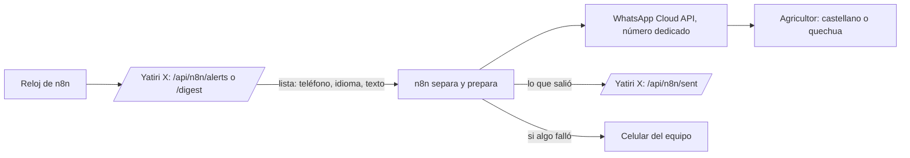

# n8n: mensajes automáticos desde el número dedicado de WhatsApp

Yatiri X decide **qué** decir y **a quién** (pronóstico por escenarios, idioma de cada persona, quién ya recibió
qué). n8n decide **cuándo** y **envía** con el número boliviano del equipo. Así cualquiera del equipo puede cambiar
horarios, pausar envíos o agregar pasos sin tocar el código.

## Los cuatro flujos (`n8n/workflows/`)

| Archivo | Cuándo | Qué hace |
| --- | --- | --- |
| `1-avisos-urgentes.json` | 7:00, 12:00 y 17:00 (hora de Bolivia) | Helada o lluvia fuerte en los próximos dos días. Un aviso por persona por día. |
| `2-resumen-semanal.json` | Lunes 7:00 | Días con lluvia y helada de la semana, lluvia frente a lo normal, cómo suele ser el mes y un consejo. |
| `3-aviso-de-prueba.json` | Al pulsar «Probar ahora» | Mensaje de prueba a cada persona suscrita, en su idioma. Para la demo. |
| `4-vigilancia.json` | Cada 30 minutos | Si la web no responde, Tiri se queda sin IA, fallan las capas del GAMC o WhatsApp pierde las credenciales, escribe al celular del equipo. |
| `5-boletin-gmail.json` | Cada día 7:00 | **Sin WhatsApp:** revisa el servicio y el pronóstico de los terrenos de la lista y envía un boletín por Gmail; el asunto empieza con AVISO si hay helada o lluvia fuerte probable. Solo necesita la credencial de Gmail (botón *Sign in with Google*). |

Todos tienen además un botón **Probar ahora** para correrlos a mano. Cada mensaje va en el idioma que eligió la
persona: castellano, o quechua si se suscribió desde la web en quechua, escribió WILLAWAY o QUECHUA, o saludó en
quechua.

## Instalar (una vez)

1. **Clave de avisos en Netlify.** En *Netlify → yatirix-cochabamba → Environment variables*:
   - `ALERTS_SECRET`: una frase larga al azar, marcada como secreta. Ya hay una generada en el `.env` de la PC
     del líder (`ALERTS_SECRET_PRODUCCION`): cópiala de ahí. No la pegues en chats ni en el repositorio.
   - `ALERTS_SENDER` = `n8n` **solo cuando** n8n quede encendido en el servidor. Mientras no lo esté, déjala vacía
     y los avisos urgentes los envía Netlify a las 18:00.
2. **Importar los flujos.** En n8n: *Workflows → Import from file* y elegir cada archivo de `n8n/workflows/`.
   Si ya estaban, se actualizan (los ids son fijos).
3. **Dos credenciales** de tipo *Header Auth* (n8n las pide al abrir los nodos con el ícono de alerta):

   | Nombre en n8n | Name (cabecera) | Value |
   | --- | --- | --- |
   | `Yatiri X: clave de avisos (x-alerts-secret)` | `x-alerts-secret` | el `ALERTS_SECRET` de Netlify |
   | `WhatsApp Cloud API: token (Authorization)` | `Authorization` | `Bearer ` + el token permanente del usuario del sistema (paso 5 de `docs/infra/whatsapp.md`) |

4. **Nodo «Configuración»** de cada flujo:
   - `phone_number_id`: el ID del número dedicado (Meta → WhatsApp → API Setup). No es el número de teléfono.
   - `team_phone`: un celular del equipo con código de país, solo dígitos (`591…`), para los avisos de fallas.
     Ese celular debe haber escrito al número dedicado en las últimas 24 horas para recibir texto libre.
   - `base_url` y `graph_url` ya vienen bien.
5. **Activar** los flujos 1, 2 y 4 (interruptor *Active*). El 3 se usa a mano.

## Dónde corre n8n

- **Demo:** en cualquier PC del equipo con `npx n8n` (n8n solo hace llamadas hacia afuera; no necesita túnel).
- **Servidor (PC con RTX 4090):** con Docker y reinicio automático, como en `SERVIDOR.md`. Si la PC se apaga, no
  salen avisos: por eso `ALERTS_SENDER=n8n` se pone solo cuando el servidor queda estable.

Las conversaciones con Tiri (cuando la persona escribe) no pasan por n8n: Meta llama directo a
`/api/whatsapp` en Netlify, que responde en segundos aunque n8n esté apagado.

## Rutas de Yatiri X para n8n

Todas piden la cabecera `x-alerts-secret`.

| Ruta | Devuelve |
| --- | --- |
| `GET /api/n8n/alerts` | `{ items: [{ key, phone, lang, kind, risks, text, template, template_lang, mark }] }` solo de terrenos con riesgo, sin repetir en el día. Con `?test=1`, un mensaje de prueba para todos. |
| `GET /api/n8n/digest` | Lo mismo con el resumen semanal de cada persona, sin repetir en la semana. |
| `POST /api/n8n/sent` | Recibe `{ sent: [{ key, mark }] }` y marca lo enviado. |
| `GET /api/n8n/status` | Cuántas personas están suscritas, quién envía y qué plantilla se usa. |

## Reglas de WhatsApp que los flujos ya respetan

- **Plantilla:** fuera de la ventana de 24 horas, Meta solo deja escribir primero con una plantilla aprobada
  (`aviso_terreno`). El texto va como su único parámetro, en una sola línea. Meta no tiene plantillas en quechua:
  el texto en quechua viaja dentro de la plantilla en castellano.
- **Ritmo:** un mensaje por segundo.
- **Consentimiento:** solo reciben mensajes quienes escribieron ALERTAS o WILLAWAY. BAJA borra todo.
- **Fallas:** si Meta rechaza un mensaje, ese no se marca como enviado (se reintenta en la próxima corrida) y el
  equipo recibe un aviso.

## Probado

El 15 de noviembre, en n8n 2.47.7 local, contra el servidor local y una API de WhatsApp simulada: el resumen salió
en castellano y en quechua, un rechazo simulado de Meta quedó sin marcar y llegó el aviso al equipo, el aviso de
prueba salió en los dos idiomas y la vigilancia detectó que faltaban las credenciales de WhatsApp.

Para regenerar los archivos después de cambiar `scripts/build_n8n.mjs`: `node scripts/build_n8n.mjs`.
